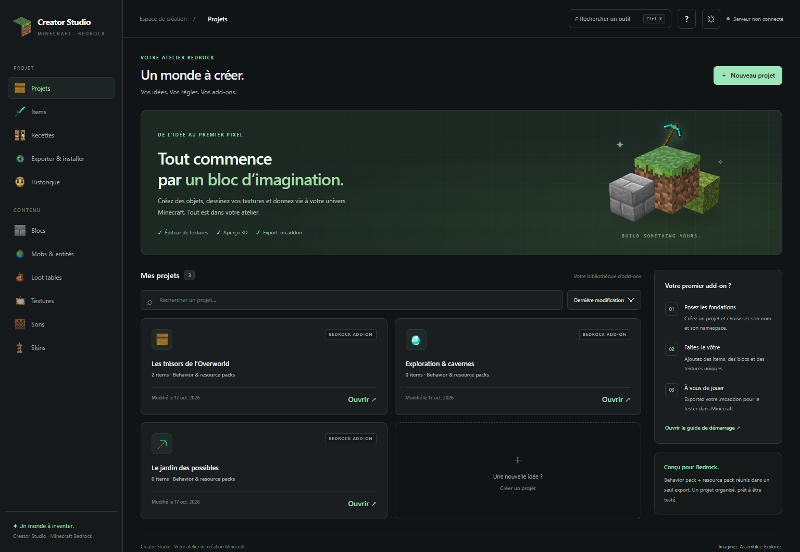

# Minecraft Creator Studio

**Imaginez. Assemblez. Explorez.**

Un atelier visuel en français pour créer des **add-ons Minecraft Bedrock** : objets, blocs, créatures, recettes, textures et skins. Créez votre contenu, prévisualisez-le et exportez-le pour le tester en jeu.



*Capture avec des projets de démonstration. Aucun projet n’est préinstallé.*

## Dans votre atelier

- **Bibliothèque de projets** avec recherche, tri par nom, date ou nombre d’items.
- **Éditeur d’items** : objets simples, nourriture, outils, armes et armures.
- **Blocs, mobs et tables de butin** : propriétés et génération des fichiers Bedrock.
- **Recettes de craft** avec un sélecteur d’ingrédients Minecraft.
- **Textures pixel par pixel**, palette, remplissage, pipette, zoom et annulation.
- **Aperçus 3D** pour les items, blocs, modèles et skins compatibles.
- **Sons et skins**, export de packs de skins au format `.mcpack`.
- **Export `.mcaddon`**, vérifications et historique des sauvegardes.
- **Thèmes sombre et clair**, navigation mobile, guide intégré et recherche d’outils.

## Démarrer

Prérequis : **Node.js 22 ou version compatible plus récente**, npm et un navigateur récent. `better-sqlite3` est une dépendance native ; si aucun binaire compatible n’est disponible pour votre système et votre version de Node.js, npm peut demander les outils de compilation de votre plateforme.

Sous Windows, vous pouvez double-cliquer sur **`ouvrir-studio.bat`** : il installe les dépendances si nécessaire, démarre le studio. Ouvrez ensuite l'adresse affichee dans le terminal dans votre navigateur. La fenêtre reste ouverte pour afficher les éventuelles erreurs. Ce raccourci choisit un port libre a partir de 5930 si une autre instance est ouverte.

Ou, depuis un terminal dans le dossier du projet :

```sh
npm ci
npm start
```

Ouvrez **http://127.0.0.1:5930/**. Gardez le terminal ouvert pendant l’utilisation. `Ctrl+C` arrête le studio.

Le serveur écoute uniquement sur `127.0.0.1`. Une connexion Internet est nécessaire pour la première installation. Three.js est ensuite servi depuis les dépendances locales ; les polices Google sont facultatives, avec une police système en remplacement.

## Votre premier add-on

1. Cliquez sur **Nouveau projet**, choisissez un nom et un namespace, par exemple `mon_addon`.
2. Ouvrez **Items** ou un autre éditeur, puis ajoutez votre contenu.
3. Dessinez une texture ou importez un PNG et enregistrez vos modifications.
4. Dans **Exporter & installer**, consultez les vérifications et téléchargez le `.mcaddon`.
5. Importez-le dans Minecraft Bedrock sur un appareil compatible, activez les packs dans un monde de test et vérifiez leur comportement.

La compatibilité des composants dépend de la version Minecraft ciblée. Certains pouvoirs nécessitent les fonctions de script de Bedrock. Le studio ne génère pas de mods Java Edition.

### Raccourcis

| Action | Windows / Linux | macOS |
| --- | --- | --- |
| Rechercher un outil | `Ctrl+K` | `Cmd+K` |
| Enregistrer le projet | `Ctrl+S` | `Cmd+S` |
| Annuler dans l’éditeur de textures | `Ctrl+Z` | `Cmd+Z` |
| Fermer une fenêtre | `Échap` | `Échap` |

Les flèches et `Entrée` permettent de naviguer dans la recherche d’outils. Les préférences de thème sont enregistrées dans le navigateur.

## Projets et sauvegardes

Le dossier **`data/`** contient la base SQLite, l’historique, les textures, les sons et les fichiers nécessaires aux exports. **Sauvegardez tout ce dossier**, de préférence après avoir arrêté le studio.

Les projets sont stockés sur la machine qui exécute le serveur, indépendamment du navigateur. L’historique conserve les 50 dernières sauvegardes de chaque projet. Le dossier `data/` est exclu de Git pour ne pas publier les créations et journaux locaux.

## Configuration facultative

`npm start` utilise les variables d’environnement du terminal. Vous pouvez aussi copier `.env.example` vers `.env`, puis démarrer explicitement avec :

```sh
node --env-file=.env --import tsx src/server/index.ts
```

| Variable | Utilisation | Valeur par défaut |
| --- | --- | --- |
| `MCSTUDIO_PORT` | Port HTTP local du studio | `5930` |
| `MCSTUDIO_SERVER_ROOT` | Dossier du serveur Bedrock local | `/opt/minecraft/mcbedrock` |
| `MCSTUDIO_WORLD_NAME` | Nom du monde utilisé pour l’installation directe | `BillyCraft` (configuration historique) |
| `MCSTUDIO_SERVICE` | Service systemd de Bedrock | `mcbedrock` |
| `MCSTUDIO_CONSOLE_FIFO` | FIFO de console pour l’intégration CinéCam | `/opt/minecraft/mcbedrock/console.in` |

### Installation directe sur serveur

**L’export `.mcaddon` fonctionne sans serveur Minecraft.** L’installation directe et le redémarrage sont des intégrations facultatives pour un serveur Bedrock Linux local, avec systemd et les droits appropriés. Configurez les chemins et le nom du monde avant de les utiliser. Le studio prépare une sauvegarde avant l’installation ; le redémarrage se déclenche séparément après confirmation.

Le studio n’intègre pas de comptes utilisateurs ni d’authentification. Son fonctionnement prévu est local. Une exposition distante nécessite un contrôle d’accès adapté devant l’application.

### Lanceur Windows facultatif

Le dossier `pc/` contient un petit lanceur Go qui ouvre le studio dans une fenêtre Chrome ou Edge. Il **ne démarre pas le serveur Node.js**.

```sh
cd pc
go build -ldflags="-H windowsgui" -o "Minecraft Creator Studio.exe" .
```

Il ouvre `http://127.0.0.1:5930/` par défaut. La variable d’environnement `MCSTUDIO_URL` permet de choisir une autre adresse. Recompilez le lanceur pour utiliser ce comportement : un ancien `.exe` présent localement peut encore pointer vers l’ancien hébergement et est exclu de Git.

## Développement

```sh
npm run dev      # Serveur avec rechargement au changement des sources
npm test         # Tests du générateur Bedrock
npm run check    # Vérification TypeScript
```

```text
src/
  core/                    Modèles Zod et générateurs Bedrock
  server/
    ui/
      index.html           Éditeurs et interface de base
      studio.css           Habillage, thèmes et mise en page responsive
      studio.js            Bibliothèque, recherche, guide et accessibilité
    index.ts               API Express
    db.ts                  Projets et historique SQLite
    deploy.ts              Build, export et installation facultative
pc/                        Source du lanceur Windows
tests/                    Tests Vitest
tools/                    Scripts de préparation des ressources
```

Les écrans partagent les mêmes appels `/api/...`. L’interface fonctionne aussi derrière un préfixe d’URL lorsque le proxy transmet les requêtes au serveur sans ce préfixe.

Consultez [CONTRIBUTING.md](CONTRIBUTING.md) pour proposer une amélioration ou signaler un problème.

## Avant de publier

Le `.gitignore` exclut les dépendances, les données, les fichiers `.env`, les sauvegardes locales et les exécutables. Les sources du lanceur sont conservées. Aucune licence n’a été choisie dans cette refonte : ajoutez une licence adaptée avant de définir les conditions de réutilisation du code.

Projet communautaire indépendant, non affilié à Mojang ou Microsoft. Minecraft et les ressources du jeu appartiennent à leurs ayants droit. La présence des textures et modèles de référence ne leur attribue pas une nouvelle licence ; vérifiez leurs conditions de redistribution pour votre publication.
